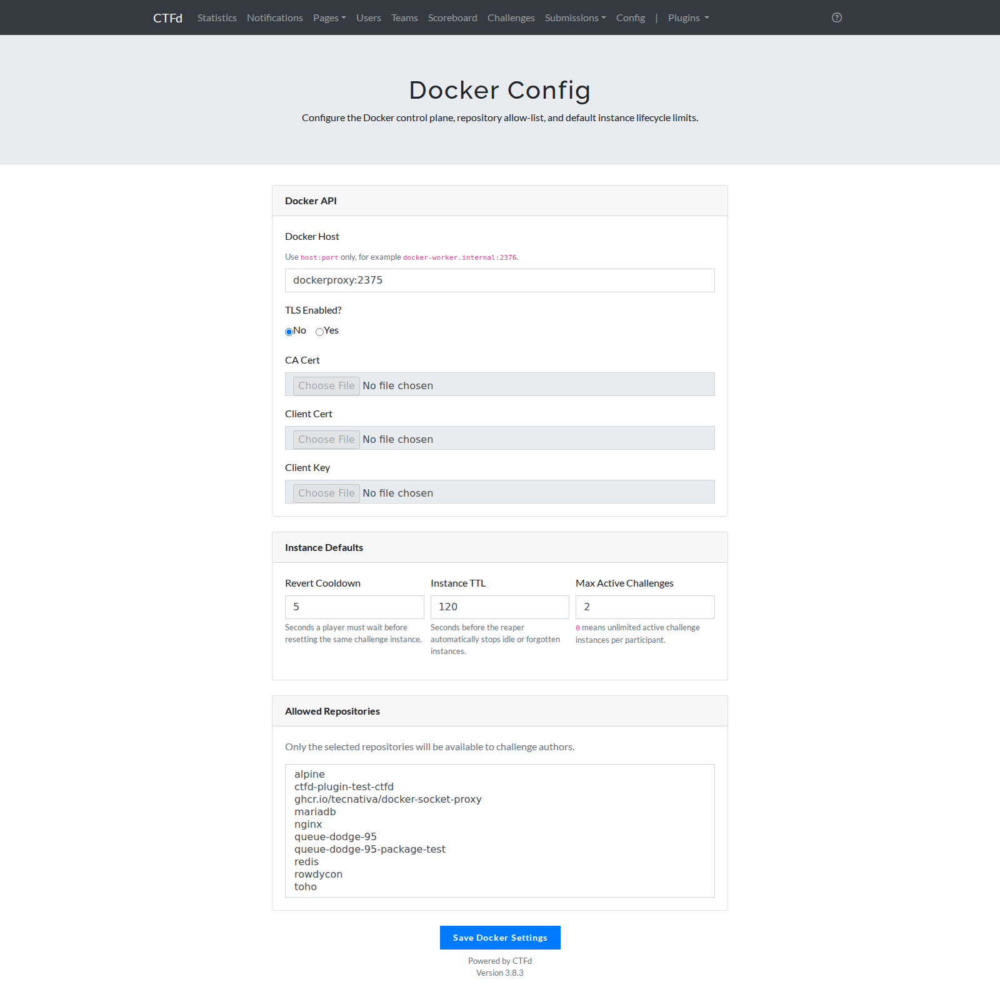
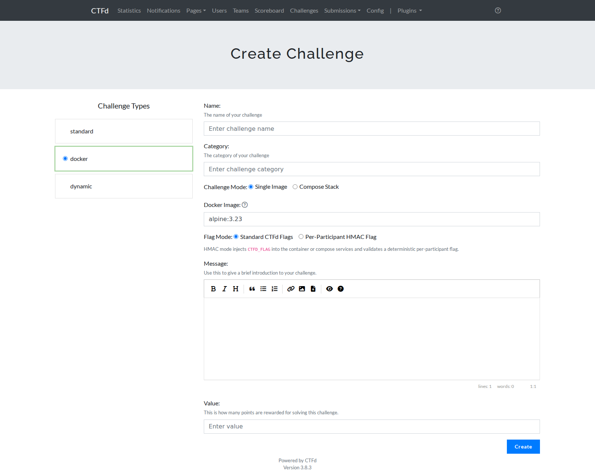
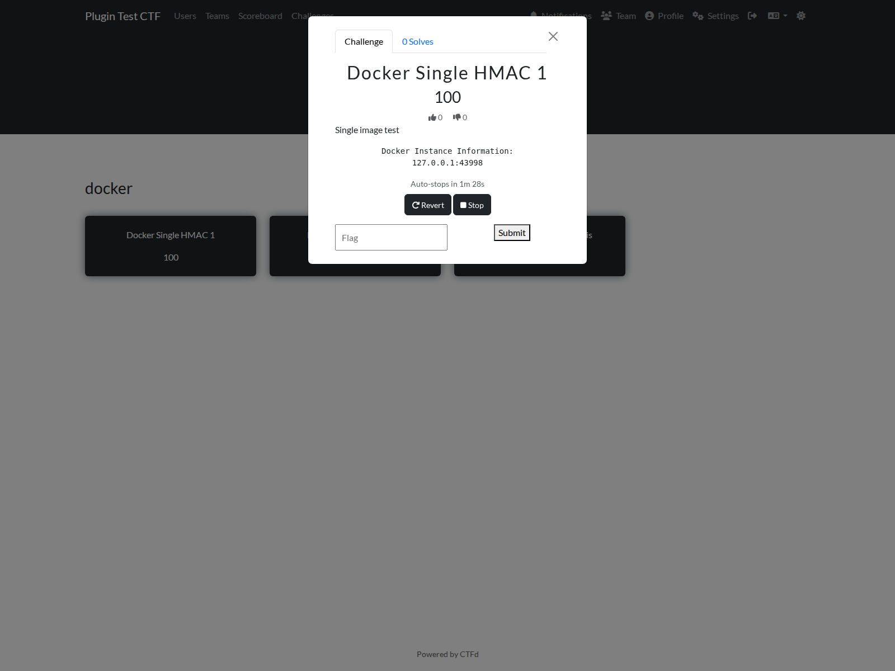
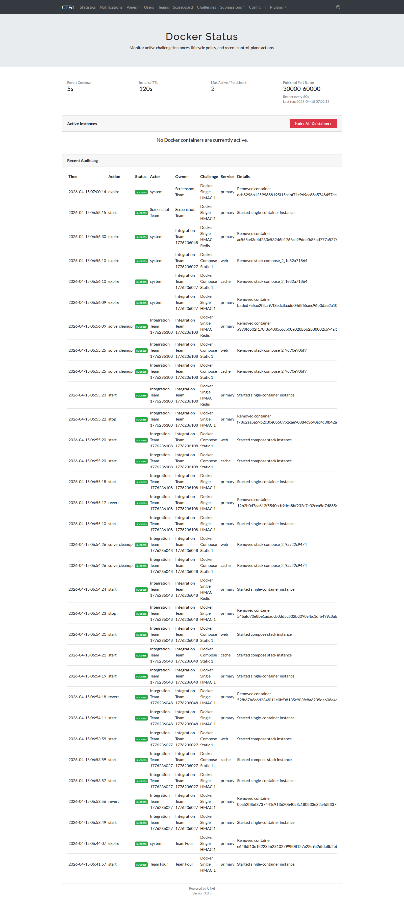

# Docker Challenge Plugin for CTFd

Adds a Docker-backed challenge type to CTFd. Players can start an isolated instance of a challenge container or compose stack, receive a dedicated connection port, and stop or revert their own environment without affecting other competitors.

The plugin publishes challenge ports on the configured Docker worker. Players connect to `DOCKER_CHALLENGE_PUBLIC_HOST:PORT`, which can be a separate FRP gateway/VPS rather than the CTFd host.

## Screenshots

### Admin Docker Configuration



### Admin Challenge Creation



### Player Challenge View



### Admin Instance Status




## Deployment options

- CTFd can use a separate Docker worker over verified mTLS.
- The plugin assigns worker ports; a centralized FRPC gateway can forward the whole reserved range.
- The public challenge hostname/IP is independent of the CTFd web hostname.
- A local internal socket proxy remains an alternative for existing single-host deployments.

## Installation

1. Copy the plugin folder into your CTFd plugins directory:

```text
CTFd/plugins/docker_challenges
```

2. If you build CTFd as a Docker image, rebuild the image so the plugin requirements are installed.

3. Start or restart CTFd.

4. Open the plugin configuration page:

```text
/admin/docker_config
```

5. Open the runtime status page when needed:

```text
/admin/docker_status
```


